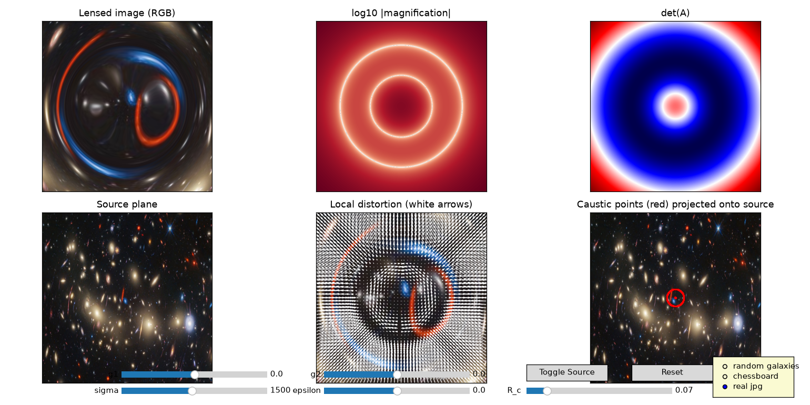

# Gravitational Lensing Explorer

An interactive Python simulator of strong gravitational lensing. It ray-traces light from background galaxies through a softened elliptical lens with external shear, and shows the lensed image, magnification map, Jacobian determinant, local distortion field and caustics, all updating live as you move the sliders.


_Built by **Samuel Gibbins** (BSc Physics, University of Nottingham), December 2025._

## Physics
The lens equation maps each image-plane position **r** = (r₁, r₂) to a source-plane position **s**:

$$s_1 = r_1 - \frac{(1-\varepsilon)\,r_1}{\sqrt{r_c^2 + (1-\varepsilon)r_1^2 + (1+\varepsilon)r_2^2}}, \qquad s_2 = r_2 - \frac{(1+\varepsilon)\,r_2}{\sqrt{r_c^2 + (1-\varepsilon)r_1^2 + (1+\varepsilon)r_2^2}}$$

- **Einstein radius** from the lens velocity dispersion: θ_E = 4π(σ/c)² · D_ls/D_s
- **Core radius** in normalised units: r_c = R_c / (D_l θ_E)
- **Ellipticity** ε, plus optional **external shear** (γ₁, γ₂)
- **Jacobian** A = I − ∂α/∂θ by central finite differences, giving the magnification μ = 1/det A. Critical curves are where det A → 0, and they are projected into the source plane as **caustics**.

Default parameters: σ = 1500 km/s, R_c = 0.07 h⁻¹ Mpc, D_l = 637, D_s = 878, D_ls = 441 h⁻¹ Mpc.

## What's in the repo
| File | What it shows |
|---|---|
| `lens_explorer.py` | **The full interactive tool.** Six panels, sliders for σ, ε, R_c, γ₁, γ₂, and a choice of source (random galaxies, chessboard or a real JPEG) |
| `gravproject.py` | Original test case: point source to Einstein ring, checked against the analytic radius |
| `scripta.py` | Basic lens mapping (point, ring, grid or Gaussian sources) |
| `scriptb.py` | Magnification map and caustics |
| `scriptc.py` | Random galaxy field (multiple extended sources) |
| `scriptd.py` | Lensing a real JPEG with bilinear sampling |
| `scripte.py` | Chessboard source with a local distortion vector field |
| `scriptf.py` | First interactive slider GUI |
| `gravitational-lensing-in-python.pdf` | Write-up with figures (Einstein ring at ε = 0, four images at ε = 0.2, and more) |

The scripts build up step by step, from a single point source to the full explorer.



## Run it
```bash
pip install -r requirements.txt
python lens_explorer.py
```
Put any image named `source.jpg` in the folder to lens it with the **real jpg** option.

## Implementation notes
- Fully vectorised NumPy: the whole N×N image plane (default 601²) is ray-traced in one pass, with no Python loops over pixels.
- Inverse ray-tracing with a hand-written **bilinear interpolator** for smooth sampling of the source.
- Principal stretch directions come from a closed-form eigen-decomposition of AᵀA, also vectorised.

## Credits
`source.jpg` is a James Webb Space Telescope image (NASA, ESA, CSA, STScI), used for demonstration.
